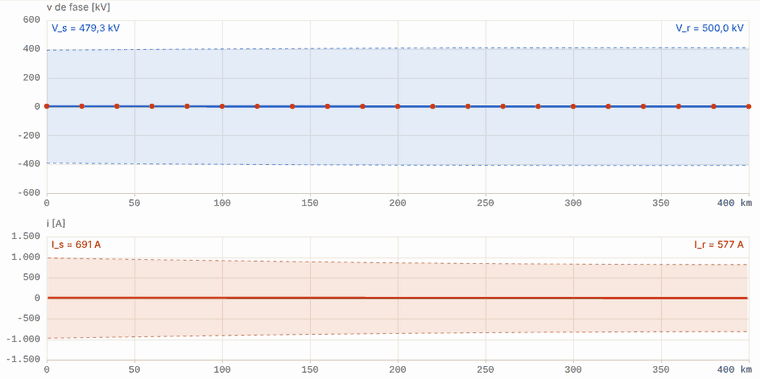
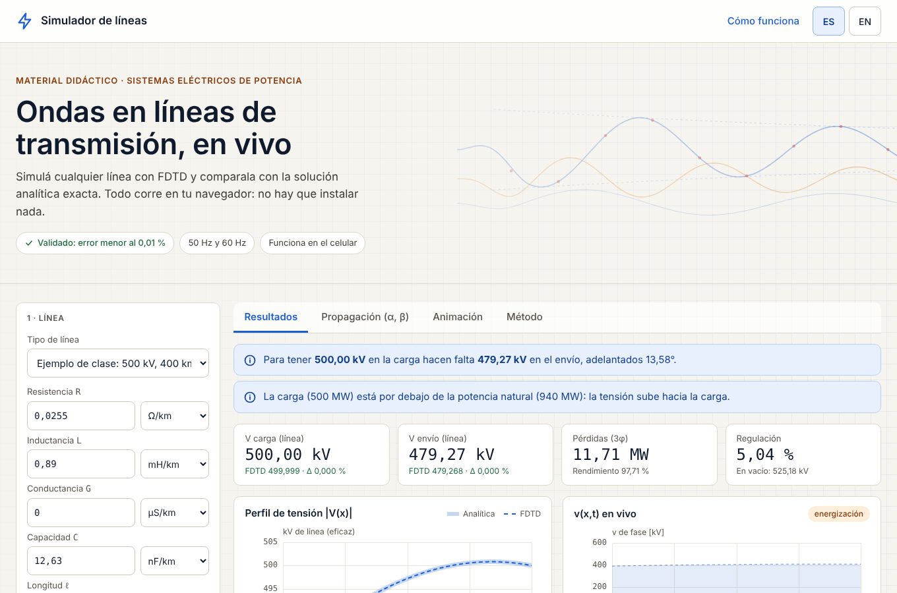
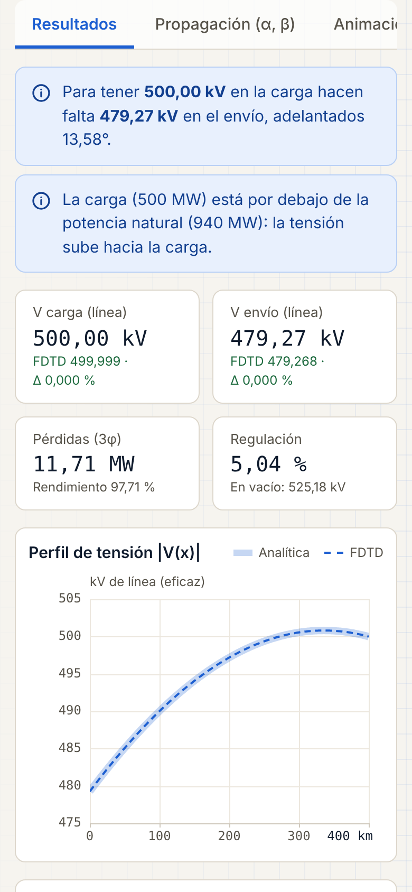
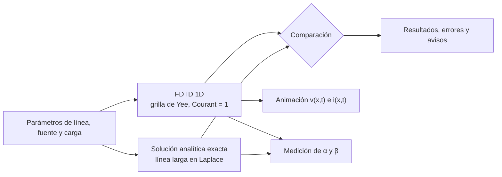
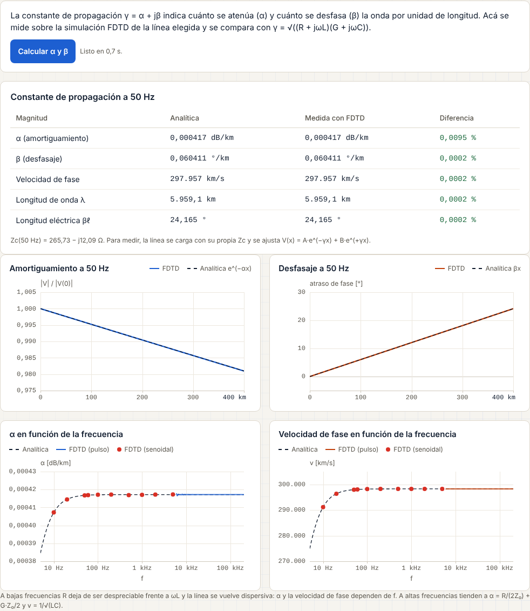

# ⚡ Simulador de líneas de transmisión

**Las ecuaciones del telegrafista, resueltas en vivo en el navegador con FDTD y validadas contra la solución analítica exacta.**

**Autores:** Jorge Ariel Santillán y Ayelén Gisela Cutraro

### [▶ Usar el simulador](https://simulador-lineas.vercel.app)

*[English summary below](#english)*

---

## El problema

En Sistemas Eléctricos de Potencia, conceptos como las ondas viajeras, la reflexión, el efecto Ferranti, la constante de propagación o la potencia natural de una línea se enseñan con fórmulas fasoriales y quedan abstractos. Los programas profesionales (PSS/E, ATP/EMTP) resuelven el problema, pero no muestran qué pasa *dentro* de la línea.

## La solución

Una página web gratuita, pensada como material didáctico, donde cualquiera puede:

- **definir la línea:** R, L, G, C y longitud, con unidades seleccionables;
- **definir la carga:** por MVA y factor de potencia, por impedancia, o en circuito abierto, cortocircuito o adaptada;
- **elegir la fuente:** senoidal a 50 o 60 Hz, con la tensión fijada en el envío o en la carga, onda cuadrada o pulso;
- **ver la onda viajar y reflejarse** a lo largo de la línea, en tiempo real, con la solución analítica superpuesta;
- **obtener los resultados de régimen:** tabla por fase y trifásica, pérdidas, rendimiento, regulación, efecto Ferranti y comparación con la potencia natural (SIL);
- **medir α y β** sobre la simulación y compararlos con la teoría;
- **exportar** la animación en video y las formas de onda en CSV.

Funciona en la computadora y en el celular, en **español e inglés**, y **sin servidor**: todo se calcula en el navegador de cada usuario.

## Cómo funciona

- **FDTD:** la línea se discretiza en una grilla de Yee 1D (tensión en los nodos, corriente a media celda, salto de rana) con paso Δt = Δx/v. En x = 0 hay un generador de Thevenin y en x = ℓ una carga concentrada R, R-L o R-C, integrada con la regla trapezoidal.
- **Analítica:** solución exacta de línea larga en el dominio de Laplace, con todas las reflexiones múltiples. Para la senoidal se resuelve con fasores; para pulsos y ondas cuadradas se vuelve al tiempo con una **transformada de Laplace numérica** (s = σ + jω y FFT).
- **α y β desde la simulación:** la línea se carga con su propia Zc y se ajusta V(x) = A·e^(−γx) + B·e^(+γx) con Levenberg-Marquardt. En banda ancha, un pulso registrado en dos puntos da H(f) = e^(−γΔx).

## Validación

Cada número que muestra la página se compara con una solución exacta, y hay una batería de pruebas automáticas:

| Caso | Analítico | FDTD |
|---|---|---|
| Efecto Ferranti, 500 kV, 1000 km en vacío | V_r/V_s = 2,059 | 2,059 |
| Línea de 400 km, 500 kV y 500 MVA (fp 1) en la carga: tensión de envío | 479,27 kV | 479,27 kV |
| Mismo caso: pérdidas trifásicas | 11,705 MW | 11,705 MW |
| Pulso con carga R-L y onda cuadrada con carga R-C | — | error L2 < 0,06 % |
| Reflexión en carga abierta, corto y adaptada | Γ = +1, −1, 0 | +1,000 · 0 · 0,000 |
| α y β a 50 y 60 Hz | — | error < 0,01 % |
| α(f) y β(f) de 10 Hz a 170 kHz | — | error mediano < 0,001 % |

## Decisiones técnicas

- **Sin servidor.** El cálculo corre en el navegador, así que 40 alumnos a la vez no cargan ningún servidor y la página funciona sin conexión una vez abierta. Para eso, el núcleo se escribió en JavaScript sin librerías: aritmética compleja, FFT, FDTD, Laplace numérica y ajuste no lineal.
- **Doble implementación.** El núcleo se desarrolló primero en Python (NumPy y SciPy) y después se llevó a JavaScript. Las dos versiones se validan contra los mismos casos y dan los mismos resultados.
- **Medir α, que es muy chico.** α ≈ 0,0004 dB/km, así que una reflexión residual del 0,1 % en la carga alcanzaba para dar un 3 % de error. Ajustar también la onda reflejada lo bajó a menos del 0,01 %.
- **Ambigüedad de fase.** La fase de H(f) solo se conoce módulo 2π; el múltiplo correcto se fija con la estimación ω/v.
- **Amplitud de régimen.** Se mide con la componente fundamental (DFT del último ciclo) y no con el valor máximo, porque el transitorio de energización puede no haberse extinguido. La página avisa cuando todavía no se llegó al régimen.
- **Costo numérico.** Con Courant = 1, una línea corta a 50 Hz necesita cientos de miles de pasos. Se limita a 300 000 pasos y se reducen las celdas, avisándole al usuario.
- **Animación didáctica.** Se guardan perfiles finos (36 por ciclo) solo durante la energización y en los últimos ciclos, para que la senoidal se vea oscilar sin efecto estroboscópico y sin gastar memoria.
- **Diseño y accesibilidad.** Contraste según las pautas de accesibilidad, controles de 44 px, pestañas manejables con teclado, respeto de la preferencia de "reducir movimiento" y fondo decorativo que nunca queda detrás del texto.

## Tecnologías

HTML, CSS y JavaScript (módulos ES, Canvas 2D, MediaRecorder), sin frameworks. Python, NumPy y SciPy para la versión de referencia y la validación. Publicado en Vercel.

## Código fuente

El código fuente es privado. **Está disponible a pedido para procesos de selección.** Escribinos y lo mostramos con gusto.

Contacto: georgesantillan1617@gmail.com ·

---

## English

An interactive, free web simulator of the **telegrapher's equations**, built as teaching material for Electric Power Systems courses. It solves the line with **FDTD** in the browser and checks every result against the **exact long-line analytical solution** (phasors and numerical inverse Laplace transform).

**Users can:**
- set line parameters with selectable units;
- define the load in MVA and power factor;
- choose a 50/60 Hz sine (with the voltage specified at the sending or receiving end), a square wave or a pulse;
- watch waves travel and reflect;
- get steady-state tables, losses, regulation and the Ferranti effect;
- measure the propagation constant α and β;
- export videos.

It is available in Spanish and English and needs no server.

**Validation:** Ferranti ratio 2.059 for a 1000 km, 500 kV line; sending-end voltage 479.27 kV for a 400 km line delivering 500 MVA; transient L2 errors below 0.06%; α and β within 0.01%.

**Source code** is private and available on request for hiring processes.

**Authors:** Jorge Ariel Santillán and Ayelén Gisela Cutraro. © 2026, all rights reserved.
